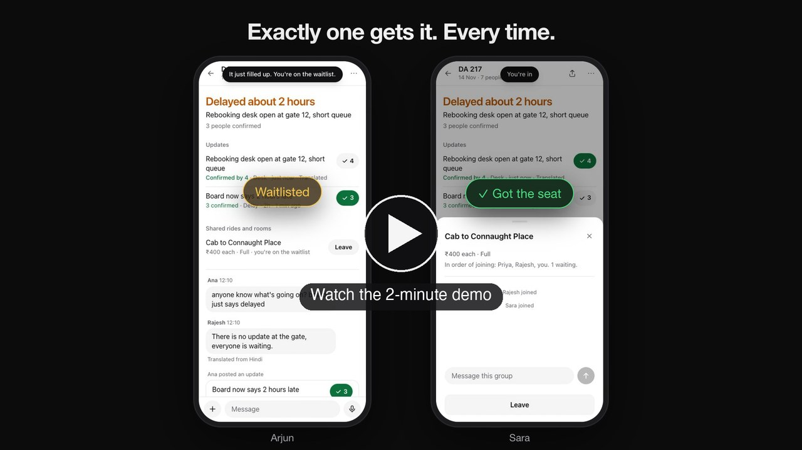
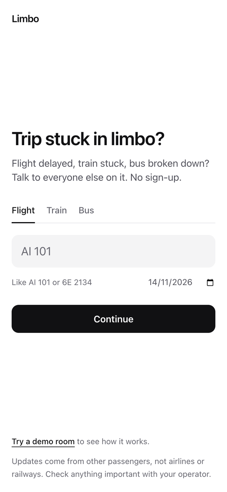
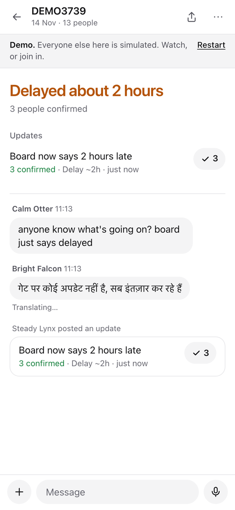
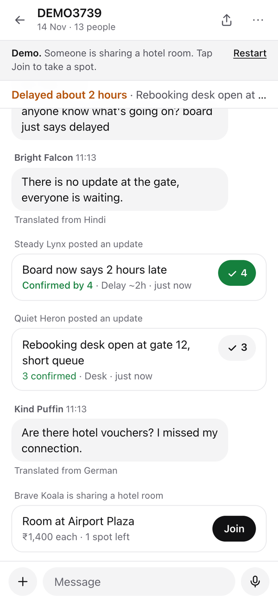
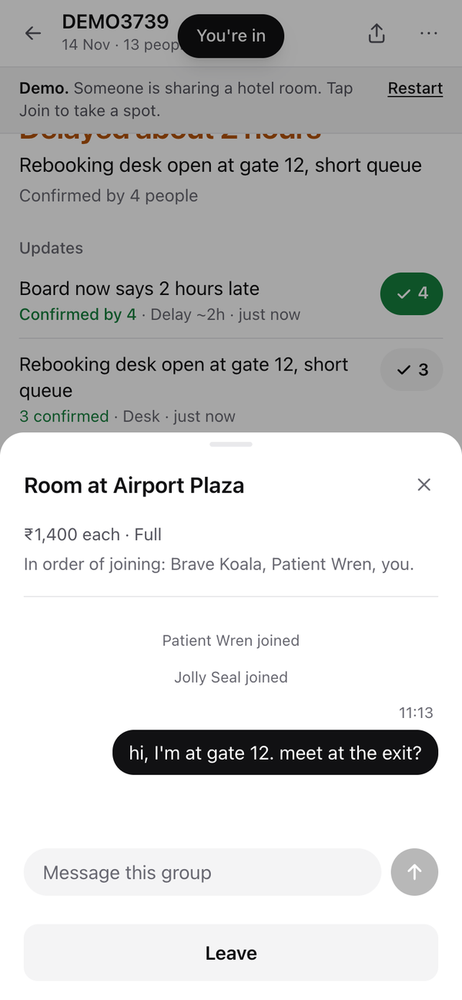
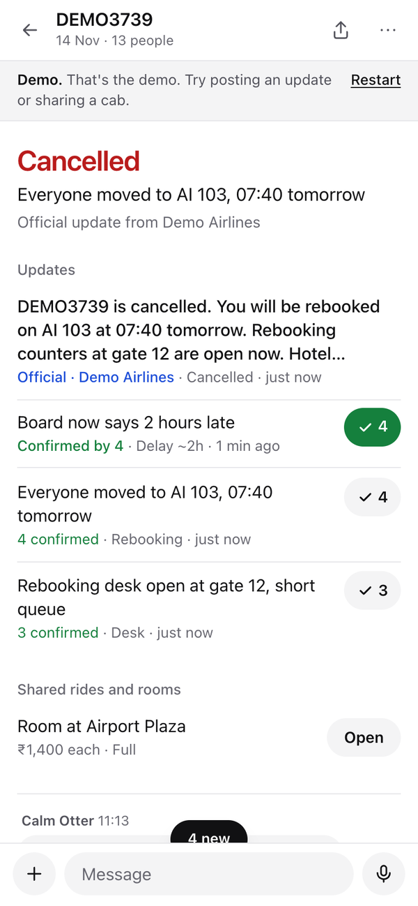

<p align="center">
  
</p>

<h1 align="center">Limbo</h1>

<p align="center"><b>When your trip is stuck, you're not stuck alone.</b></p>

<p align="center">
  When a flight is cancelled or a train sits in fog, hundreds of people share the same problem and have no way to talk
  to each other. Limbo gives every flight, train and bus a room that exists before anyone joins. Type your trip number
  and you are in it, with everyone else on that trip: what's confirmed, who's sharing a cab, in your own language.
</p>

<p align="center">
  <i>Made by Team maxout for the <a href="https://reskilll.com/hack/nexconn/">Nexconn Build Challenge 2026</a></i>
</p>

<p align="center">
  <a href="08_how_nexconn_is_used"></a>
  <a href="10_tested_for_real"></a>
  <a href="09_the_demo_room"></a>
  <a href="LICENSE"></a>
  <a href="https://limbo-sooty.vercel.app"></a>
  <a href="https://youtu.be/bTRSKyyD-l0"></a>
  <a href="report/limbo-report.pdf"></a>
</p>

<p align="center">
  <a href="https://youtu.be/bTRSKyyD-l0"></a>
</p>

---

## TL;DR

| | |
|---|---|
| **Problem** | A trip goes wrong and everyone on it has the same questions: how late, which desk, is there a hotel, is anyone sharing a cab? They share a context but have no channel. Nobody can create the group, and strangers don't have each other's numbers. |
| **Idea** | A flight number and a date are public. So the room can exist **before anyone joins**: the first person to type `AI 101` opens it, and the second person is already in a room with the first. No organiser, no invite, no sign-up. |
| **What's inside** | A plain-English **status** at the top ("Delayed about 2 hours, confirmed by 4 people"), **updates** anyone can confirm with one tap, **shared cabs and rooms** where the last seat goes to exactly one person, **translation** of every message, and **official updates** from verified staff that nobody else can fake. |
| **How Nexconn is used** | A **community channel** per trip, a private **group channel** per shared cab, **custom message types** for updates and pools, **message metadata** for live tallies, **history** for latecomers, **built-in translation**, and the **Server API** for tokens, channels and server-sent cards. |
| **Trust** | Vote counts and seat lists live in Nexconn message metadata, which any member could edit from a browser. So the server signs every state with Ed25519 and every client checks the signature. Edited or replayed state is ignored. |
| **Tested** | 20 unit tests, a 32-check API suite and three browser suites (58 end-to-end checks), all against a real Nexconn app: three people in one room, two people racing for one seat, a passenger who loses Wi-Fi and catches up in under a second, and eight people racing for one seat 30 times with exactly one winner every time. |

<p align="center">
  
  
  
  
  
</p>

---

## For judges, in two minutes

1. Open **[limbo-sooty.vercel.app](https://limbo-sooty.vercel.app)** and tap **Try a demo room**. You get a private room for a delayed flight with eleven simulated
   passengers and one simulated airline desk, clearly labelled. Over about 80 seconds: a desk is found (tap ✓), a
   German and a Hindi message arrive translated, someone shares a hotel room (tap **Join** for the last spot), and the
   airline posts an official cancellation that is pinned to the top.
2. For the real thing, open any flight or train number in two browsers (a normal and a private window). Post an
   update in one and confirm it in the other.
3. Nexconn App Key: **`ik1qhw09iruvp`** (Singapore data centre).
4. The [write-up](report/limbo-report.pdf) covers the design, the trust model and the measurements in five pages, and
   the [demo video](https://youtu.be/bTRSKyyD-l0) shows the whole thing in two minutes (also in the repo as
   [`assets/demo/limbo-demo.mp4`](assets/demo/limbo-demo.mp4)).

---

## The story, in twelve chapters

Each folder is one chapter: a README that tells that part of the story and links to the code that does it. The app
itself lives in a standard Next.js layout under [`src/`](src) so it runs with one command.

| | Chapter | What it covers |
|---|---|---|
| 01 | [The problem](01_the_problem) | The moment a trip goes wrong, and why every existing tool fails at it |
| 02 | [The idea](02_the_idea) | A room that exists before anyone joins, in one picture, and the rules we held ourselves to |
| 03 | [The room](03_the_room) | Trip numbers as public keys, lazy community channels, and guests with no sign-up |
| 04 | [The board](04_the_board) | Updates as custom messages, one-tap confirm, and a confidence score you can explain in a sentence |
| 05 | [Trust](05_trust) | Signed state, an Official badge nobody can fake, and the other ways people could abuse a room |
| 06 | [Fair shares](06_fair_shares) | Shared cabs and rooms where the last seat goes to exactly one person |
| 07 | [Every language](07_every_language) | Built-in translation, voice input, large text, dark mode |
| 08 | [How Nexconn is used](08_how_nexconn_is_used) | Every SDK and Server API call, and what we learned by probing the live API |
| 09 | [The demo room](09_the_demo_room) | A labelled, simulated crowd for anyone testing alone, running on the real stack |
| 10 | [Tested for real](10_tested_for_real) | The suites, the numbers, and the bugs they caught |
| 11 | [The business](11_the_business) | Free for travellers, paid by the people who want calmer passengers |
| 12 | [Run it yourself](12_run_it_yourself) | Setup, Nexconn console settings, tests, deployment and admin tools |

---

## How Nexconn is used

| Feature | Nexconn capability | Where |
|---|---|---|
| One room per trip, up to 10,000 people | **Community channel**, created lazily by the server on first visit | [`rooms.ts`](src/lib/server/rooms.ts) |
| No sign-up | **Server API** `access-token/issue` for a random guest ID; the browser never sees the App Secret | [`session/route.ts`](src/app/api/session/route.ts) |
| Updates, shared rides, notices | **Custom message types** `Limbo:Intel`, `Limbo:Pool`, `Limbo:Notice`, sent by the server on the author's behalf | [`cards.ts`](src/lib/shared/cards.ts) |
| Live vote counts and seat lists | **Message metadata**, set by the server and pushed to every client by `onCommunityChannelMessageMetadataChanged` | [`room-store.ts`](src/lib/client/room-store.ts) |
| Private chat for a shared cab | **Group channel** per pool; people join only by claiming a seat (`joinPerm: 3`) | [`pools.ts`](src/lib/server/pools.ts) |
| Latecomers see what happened | **Message history** (`createMessagesQuery`), with "Earlier messages" paging | [`room-store.ts`](src/lib/client/room-store.ts) |
| Everyone reads in their language | **Built-in translation** (`translateMessages`, results via `TranslateHandler`) | [`room-store.ts`](src/lib/client/room-store.ts) |
| Chat | Plain **text messages** sent from the browser with the Web SDK | [`Composer.tsx`](src/components/room/Composer.tsx) |

The full list of calls, and the things we only found out by probing the live API, are in
[chapter 08](08_how_nexconn_is_used).

---

## Quick start

```bash
cp .env.example .env.local        # add your Nexconn App Key and App Secret, then generate the other secrets
createdb limbo && npm install && npm run db:migrate
npm run dev                       # http://localhost:3000, and /demo for the demo room
npm test && npm run e2e           # unit tests, then every end-to-end suite against the running app
```

Console settings, secrets and deployment are in [chapter 12](12_run_it_yourself).

---

## Built during the challenge

Everything in this repository was written for the Nexconn Build Challenge, starting on 13 November 2026. Before that
there was only the idea and a written product spec; no code, design or earlier app. It was built with the help of an AI
coding assistant (Claude Code).

---

<div align="center">

*When your trip is stuck, you're not stuck alone.*

**Team maxout** · MIT

</div>
